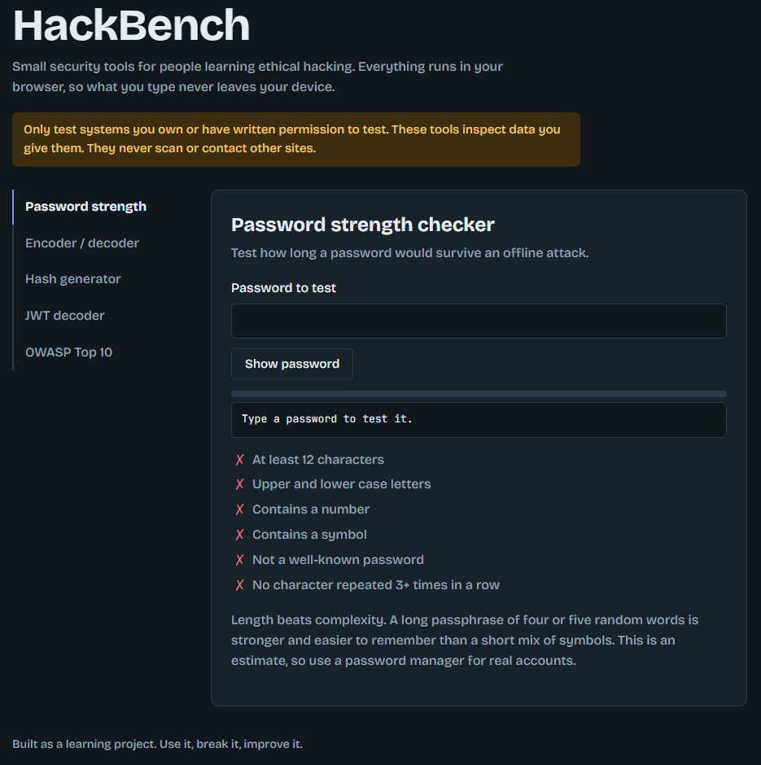
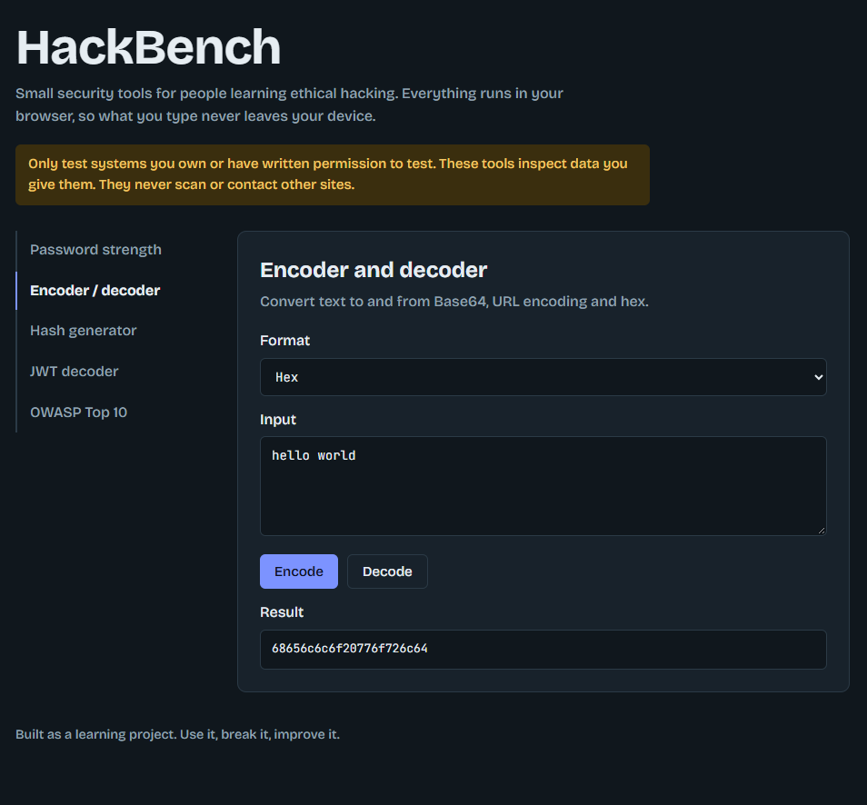
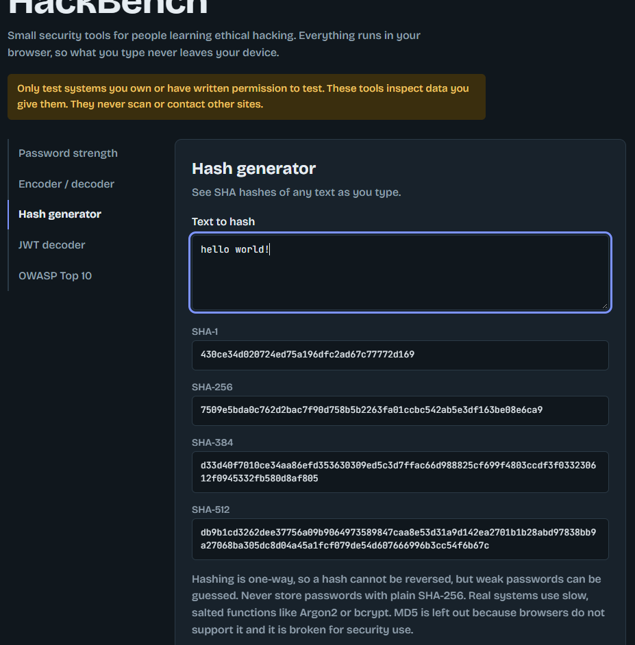
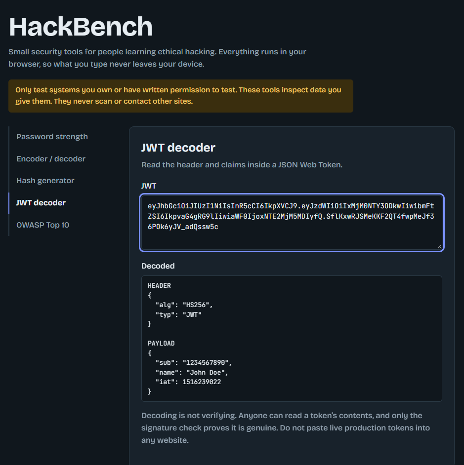
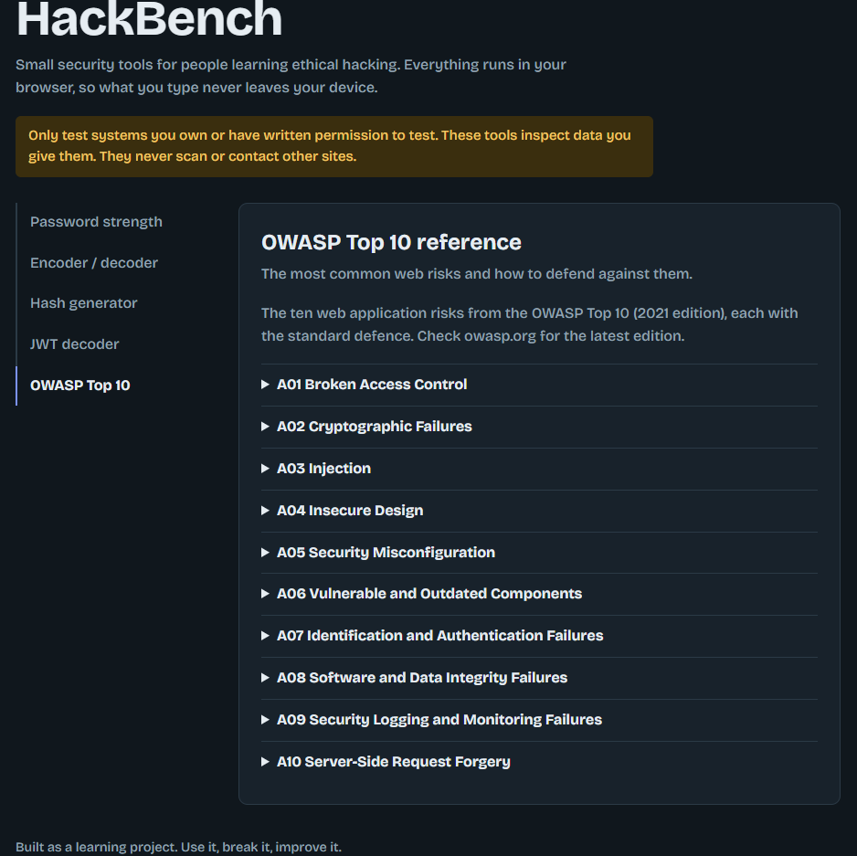

# HackBench

Free, browser-based security tools for people learning ethical hacking.

**Live site:** https://YOUR-PROJECT.vercel.app

HackBench is a small toolkit I built while learning cybersecurity. Everything runs **client-side in your browser**, so nothing you type is ever sent to a server. It does not scan or contact any other website.

> **Ethics note:** Only test systems you own or have written permission to test. These tools inspect data you paste in and nothing else.

## Tools

| Tool | What it does |
| --- | --- |
| **Password strength checker** | Estimates entropy and how long an offline attack would take, with a checklist of common weaknesses |
| **Encoder / decoder** | Converts text to and from Base64, URL encoding, and hex, with clear errors on bad input |
| **Hash generator** | Shows SHA-1, SHA-256, SHA-384, and SHA-512 hashes live as you type (Web Crypto API) |
| **JWT decoder** | Reads the header and claims of a JSON Web Token, shows the expiry time, and warns about `alg: none` |
| **OWASP Top 10 reference** | The ten most common web application risks (2021 edition), each with its standard defence |

## Security and privacy design

- **No backend, no tracking, no data storage.** All logic runs in the visitor's browser.
- **Output is written with `textContent`, not `innerHTML`,** so pasted input cannot inject HTML or scripts into the page (no self-inflicted XSS).
- **Decoding is not verifying.** The JWT tool explains that anyone can read a token and only the signature check proves it is genuine.
- **Hashing is taught honestly.** The hash tool explains why plain SHA-256 is not suitable for storing passwords and points to Argon2 and bcrypt.

## Tech stack

- HTML, CSS, and vanilla JavaScript (no frameworks, no build step)
- Web Crypto API for hashing
- Responsive layout with light and dark mode support
- Hosted on Vercel

## What I learned

- How common encodings (Base64, URL, hex) work and where they appear in web attacks and CTFs
- Why password length matters more than complexity, and why password hashing needs slow, salted algorithms
- How JWTs are structured and why `alg: none` and unverified tokens are dangerous
- How to build tools that handle untrusted input safely
- The OWASP Top 10 risks and their standard defences

## License

MIT. Feel free to use it, learn from it, and improve it.
